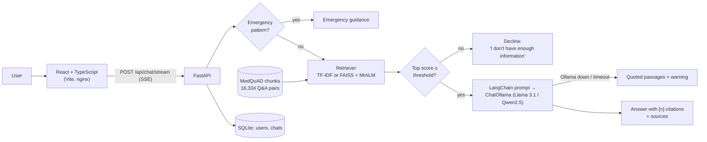

# Aarogya AI: medical Q&A with retrieval-augmented generation

Aarogya AI answers health questions using passages from **MedQuAD**: 16,334 question-answer
pairs from NIH websites such as cancer.gov, GARD, Genetics Home Reference and MedlinePlus. For
each question it retrieves the most relevant passages, asks a local LLM (Llama 3.1 or Qwen2.5
via Ollama) to answer **only from those passages and cite them as [1], [2]…**, and declines
when nothing relevant is found instead of guessing.

> ⚠️ **Disclaimer:** This project is for educational purposes only. It is not a medical device
> and must not be used for diagnosis, treatment or emergencies. Always consult a licensed
> healthcare professional for medical advice.

<!-- SCREENSHOT: save a screenshot or GIF as docs/demo.gif, then uncomment the next line. -->
<!--  -->
> 📸 _Screenshot / GIF of the chat coming soon._

## What it does

- **Grounded, cited answers.** Each answer cites the MedQuAD passages it used. The UI lists
  them with a link to the original NIH page and marks passages that were retrieved but not cited.
- **Declines off-topic or unanswerable questions.** If the best passage scores below a
  threshold calibrated on held-out data, the LLM is never called. If the model decides the
  passages don't answer the question, that is also returned as a decline.
- **Fails loudly, not silently.** If Ollama is down, slow or the model isn't pulled, the user
  sees the most relevant passages quoted verbatim with a clear note, and `/api/health` says why.
  If the dataset or index failed to load, chat returns `503` with the reason.
- **Emergency detection.** Messages like "my dad is having a heart attack" or self-harm
  statements skip the LLM and show emergency numbers. General questions ("what is a heart
  attack?") are answered normally.
- **Around the chat:** JWT accounts, chat history, streaming responses (server-sent events),
  dark mode, voice input/output, plus small tools (BMI calculator, medicine reminders) and an
  admin dashboard.

## Architecture



**How one question flows** (`backend/app/rag/pipeline.py`):

1. **Retrieve.** The question is matched against answer chunks: answers split with LangChain's
   `RecursiveCharacterTextSplitter` (500 characters, 50 overlap), each prefixed with its topic.
   The default retriever is TF-IDF with cosine similarity: pure Python, no downloads. Setting
   `RETRIEVER=faiss` switches to `all-MiniLM-L6-v2` embeddings in a LangChain FAISS store.
2. **Gate.** If the top cosine score is below `MIN_RELEVANCE_TFIDF` (0.45, calibrated on the
   dev split), the bot declines.
3. **Generate.** The top 4 chunks go into a `ChatPromptTemplate` as numbered passages. The
   system prompt requires a citation on every factual sentence and a fixed refusal sentence when
   the passages don't answer the question. `ChatOllama` uses a 5 s connect timeout and a 120 s
   read timeout.
4. **Return.** The answer streams to the browser, followed by the sources and which of them
   were cited. Everything is saved to the user's history.

## Quick start

**Prerequisites:** Python 3.11+, Node.js 20+, Git, and [Ollama](https://ollama.com) for
generated answers. Without Ollama the app still runs and shows quoted passages.

```bash
git clone https://github.com/Gargikhandekar/AarogyaAI.git && cd AarogyaAI
cp .env.example .env                      # optional: every setting has a default

# 1. Data: download MedQuAD and convert it (about 25 MB, about 1 minute)
python scripts/prepare_medquad.py         # -> dataset/medquad.json

# 2. LLM
ollama pull llama3.1:8b                   # or qwen2.5:7b, then set OLLAMA_MODEL
ollama serve                              # if it isn't already running

# 3. Backend (http://localhost:8000/docs)
cd backend
python -m venv .venv && source .venv/bin/activate   # Windows: .venv\Scripts\activate
pip install -r requirements.txt
uvicorn app.main:app --reload

# 4. Frontend (http://localhost:5173), in a second terminal
cd frontend && npm install && npm run dev
```

Check `http://localhost:8000/api/health`: it reports whether the knowledge base and the LLM
are ready, and if not, why.

**Dense retrieval (optional):** `pip install -r requirements-embeddings.txt` (adds PyTorch),
set `RETRIEVER=faiss`, and optionally prebuild the index with `python scripts/build_index.py`.
The index is saved in `vector_db/` (gitignored) and rebuilt automatically when the data,
chunking or embedding model change. Recalibrate `MIN_RELEVANCE_FAISS` with the eval script;
the default is a placeholder.

**Admin account:** set `ADMIN_EMAIL` and `ADMIN_PASSWORD` in `.env`. No default admin
password ships with the code.

### Docker

```bash
python scripts/prepare_medquad.py         # the dataset is mounted into the API container
docker compose up --build
```

- App: http://localhost:8080 (nginx serves the React build and proxies `/api`)
- API: http://localhost:8000/docs
- Ollama runs **on the host**. The API reaches it via `OLLAMA_BASE_URL`, which defaults to
  `http://host.docker.internal:11434`. Set it in `.env` to point elsewhere.
- `WITH_EMBEDDINGS=true docker compose up --build` adds the FAISS/embedding stack (CPU PyTorch).

## Configuration

All settings are environment variables, documented in [`.env.example`](.env.example). The
most important ones:

| Variable | Default | Meaning |
|---|---|---|
| `OLLAMA_BASE_URL` | `http://localhost:11434` | Where Ollama listens |
| `OLLAMA_MODEL` | `llama3.1:8b` | Any pulled Ollama model, e.g. `qwen2.5:7b` |
| `LLM_CONNECT_TIMEOUT` / `LLM_READ_TIMEOUT` | `5` / `120` s | Fail fast if Ollama is unreachable; give up if it stalls |
| `DATASET_PATH` | `dataset/medquad.json` | Q&A JSON to index |
| `RETRIEVER` | `tfidf` | `tfidf` or `faiss` |
| `CHUNK_SIZE` / `CHUNK_OVERLAP` | `500` / `50` | Characters per chunk (`0` = whole answers) |
| `TOP_K_RETRIEVAL` | `4` | Passages given to the LLM |
| `MIN_RELEVANCE_TFIDF` | `0.45` | Decline below this top score |
| `SECRET_KEY` | dev placeholder | JWT signing key. The API refuses to start with the placeholder when `APP_ENV=production` |

## Evaluation

`eval/` measures retrieval and answer quality on **held-out MedQuAD questions**. The
[eval README](eval/README.md) has the commands.

- **Data:** two disjoint splits. Each has 40 MedQuAD questions, sampled with a fixed seed from
  40 different documents, plus 10 hand-written off-topic questions the bot should decline.
  Settings (chunk size, threshold) were chosen on **dev**; the table reports **test**.
- **Leakage control:** only answer text is indexed, not the questions, so a test question
  can't simply match its own text.
- **hit@k (exact):** the gold answer is in the top-k chunks.
- **topic@k:** a chunk from the gold answer's document (same disease/topic) is in the top-k.
- **in-domain kept / OOD declined:** how the 0.45 relevance gate behaves on medical vs off-topic questions.

**Retrieval, test split, TF-IDF** ([`eval/results/retrieval_test_tfidf.md`](eval/results/retrieval_test_tfidf.md)):

| Chunk size | Chunks | hit@1 | hit@3 | hit@5 | topic@1 | topic@5 | MRR | In-domain kept | OOD declined |
|---|---|---|---|---|---|---|---|---|---|
| **500 chars** (default) | 54,732 | 0.28 | 0.47 | **0.62** | 0.68 | **0.90** | 0.39 | **0.95** | 0.90 |
| 1000 chars | 30,734 | 0.28 | 0.50 | 0.55 | 0.62 | 0.88 | 0.39 | 0.93 | 1.00 |
| Whole answer | 16,334 | 0.33 | 0.47 | 0.57 | 0.68 | 0.90 | 0.42 | 0.90 | 1.00 |

The 0.45 threshold was calibrated for 500-char chunks. With 40 questions, one question is
0.025, so differences under about 0.1 are within noise.

**What this shows:** retrieval finds the right *topic* about 90% of the time. Picking the
*exact* MedQuAD answer is harder, because each disease has several similar questions
("symptoms of X", "treatment of X") whose answers overlap. The relevance gate keeps 95% of
medical questions and blocks 90% of off-topic ones. The miss was "Translate 'good morning'
into Spanish", which matched the rare disease "Good syndrome" lexically.

**Answer quality: Llama 3.1 vs Qwen2.5.** The script generates answers through the same
pipeline and uses a local model as a judge of *faithfulness*: is every claim supported by the
cited passages? It also reports how often answers cite passages and how often off-topic
questions are declined end to end:

```bash
ollama pull llama3.1:8b && ollama pull qwen2.5:7b
python eval/run_eval.py --split test --chunk-sizes 500 1000 --models llama3.1:8b qwen2.5:7b
```

| Model | Chunk size | Answered | Faithful | Cited | OOD declined | sec/answer |
|---|---|---|---|---|---|---|
| llama3.1:8b | 500 | _not run yet_ | | | | |
| qwen2.5:7b | 500 | _not run yet_ | | | | |

_These cells stay empty until the command above has been run on a machine with Ollama; it
writes `eval/results/generation_test_tfidf.md`. No numbers here are estimated._

## Tests and CI

```bash
cd backend && pip install -r requirements-dev.txt && pytest
```

36 tests cover retrieval and chunking, citation parsing, declining off-topic questions without
calling the LLM, model refusals, the Ollama-down and timeout fallbacks, `503` when the
knowledge base is missing, the streaming protocol, per-user history isolation, emergency
detection, production config checks and the eval metric maths. They use a 52-question sample
and LangChain's fake chat model, so they need no downloads and no Ollama.
[GitHub Actions](.github/workflows/ci.yml) runs lint and tests on Python 3.11 and 3.13 and
builds the frontend on every push.

## Project structure

```
backend/app/
  rag/          documents.py (load + chunk) · retrievers.py (TF-IDF, FAISS)
                prompts.py (prompt, citations) · llm.py (Ollama + health) · pipeline.py
  api/          auth, chat (+ SSE streaming), profile, tools, admin routes
  services/     chat_service.py: persistence + RAG orchestration
  utils/        config.py (env settings) · helpers.py (emergency detection, categories)
backend/tests/  pytest suite
frontend/       React + TypeScript + Tailwind (Vite), nginx config
eval/           eval set, run_eval.py, results/
scripts/        prepare_medquad.py · build_index.py
dataset/        sample_qa.json (hand-written test fixture); medquad.json is generated
```

## Limitations

- **Not medical advice.** MedQuAD is reference text from around 2017–2019 and is not
  personalised. The bot cannot examine anyone, and its answers can be incomplete or out of date.
- **Lexical retrieval by default.** TF-IDF matches words, not meaning: synonyms ("high blood
  pressure" vs "hypertension") and misspellings can miss, and rare words can cause false
  matches ("good morning" → "Good syndrome"). The FAISS option addresses this but hasn't been
  evaluated here yet.
- **Thresholds are corpus- and setting-specific.** Changing the retriever, chunk size or
  dataset requires recalibrating the decline threshold on the dev split.
- **Small evaluation.** 40 test questions plus 10 off-topic questions per split; the questions
  are MedQuAD's own templated phrasings, not real user questions. The LLM-as-judge score uses a
  local model and inherits its biases (a model may judge its own answers leniently).
- **Citations are checked for format, not truth.** The app verifies that `[n]` refers to a
  real passage. Whether the passage supports the sentence is only measured offline by the judge.
- **Chunking artefacts.** A long answer can leave a short, uninformative last chunk.
- **Coverage.** Three MedlinePlus subsets (drugs, herbs/supplements, A.D.A.M. encyclopedia)
  ship without answers, so drug questions are poorly covered.
- **Emergency detection is keyword-based** and will miss unusual phrasings. It errs towards
  showing the warning.
- **Single-node demo.** SQLite, in-process index, no conversation memory between turns.

## Dataset and licence

MedQuAD: Asma Ben Abacha and Dina Demner-Fushman, *"A Question-Entailment Approach to
Question Answering"*, BMC Bioinformatics 2019. Distributed under CC BY 4.0 at
https://github.com/abachaa/MedQuAD. This repository does not redistribute the dataset;
`scripts/prepare_medquad.py` downloads it.
